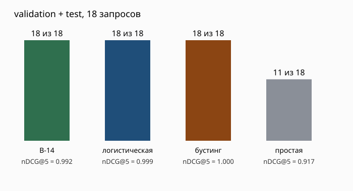

# Эксперимент с обучаемым порядком кандидатов

Проверили, стоит ли заменять формулу B-14 моделью. Сравнили четыре способа расставить **уже допущенных** кандидатов: простую сортировку по числу совпавших навыков, формулу B-14, логистическую регрессию и градиентный бустинг. Допуск по подтверждённой специализации и грейду одинаковый для всех способов; модель его не меняет.

## Данные и расчёт

В [учебном наборе](../ml-service/data/ranking_experiment_v1/README.md) 90 вымышленных Backend-профилей, 48 потребностей и 648 допустимых пар «потребность — кандидат». Для обучения моделей использовали 540 пар. Ещё 54 пары оставили для проверки во время разработки (`validation`), 54 — для итоговой проверки (`test`). Кандидаты и потребности между частями не повторяются.

Метка пары — 0 («не подходит»), 1 («можно рассмотреть») или 2 («подходит»). Её создаёт правило по навыкам, формату, городу и зарплате. Это **не оценка работодателя**. Результат теста и ФСП в правило метки не входят.

Обе модели получают шесть чисел: долю совпавших навыков с учётом веса, результат теста, совпадение формата, совпадение города, попадание зарплаты в бюджет и наличие достижения ФСП. Логистическая регрессия стандартизирует признаки и получает равный суммарный вес классов. Бустинг использует 100 деревьев глубиной до 2, скорость обучения 0,1. Настройки зафиксированы в скрипте; подбора параметров по `validation` не было. Для сортировки берём ожидаемую метку из вероятностей трёх классов.

Для каждого запроса считаем:

- **Подходящий первый** — кандидат с меткой 2 на первом месте;
- **P@3** — доля кандидатов с меткой 2 среди первых трёх;
- **nDCG@5** — насколько близок порядок первых пяти к порядку по меткам 0/1/2 (1 — полное совпадение).

## Результаты

| Часть | Сортировка | Подходящий первый | P@3 | nDCG@5 |
|---|---|---:|---:|---:|
| validation, 9 запросов | Простая | 6/9 | 0,333 | 0,918 |
| validation, 9 запросов | B-14 | 9/9 | 0,333 | 0,987 |
| validation, 9 запросов | Логистическая регрессия | 9/9 | 0,333 | 0,999 |
| validation, 9 запросов | Бустинг | 9/9 | 0,333 | 1,000 |
| test, 9 запросов | Простая | 5/9 | 0,333 | 0,917 |
| test, 9 запросов | B-14 | 9/9 | 0,407 | 0,996 |
| test, 9 запросов | Логистическая регрессия | 9/9 | 0,407 | 0,998 |
| test, 9 запросов | Бустинг | 9/9 | 0,407 | 1,000 |

**На этом наборе лучший nDCG дал бустинг.** У формулы, логистической регрессии и бустинга подходящий кандидат стоит первым во всех проверочных запросах; у простой сортировки — не всегда. По P@3 модели не обогнали формулу. Разница между B-14 и бустингом на `test` составляет 0,004 nDCG при девяти запросах.

Метки созданы правилом из тех же признаков, которые получают модели. Поэтому числа показывают, насколько точно способы повторяют **это синтетическое правило**, а не качество подбора в реальном найме. Тест и ФСП с меткой почти не связаны именно потому, что правило их не использует. Для текущей выдачи оставили понятную формулу B-14. Возвращаться к вопросу о модели имеет смысл после независимых оценок реальных пар в B-32.



Дополнительные графики: [связь признаков с меткой](../ml-service/feature_correlation.svg), [коэффициенты логистической регрессии](../ml-service/logistic_coefficients.svg), [важность признаков бустинга](../ml-service/boosting_importance.svg). Они описывают учебный набор и не являются оценкой реальных кандидатов.

## Как повторить

Из корня репозитория:

```bash
uv run --with scikit-learn==1.7.2 --with matplotlib==3.10.7 python ml-service/train_ranking_experiment.py
```

Скрипт заново обучает модели только на `train`, сохраняет их оценки для всех пар `validation` и `test` в `logistic_predictions.jsonl` и `boosting_predictions.jsonl` рядом с данными, пересчитывает таблицу и графики. Для отдельной проверки сохранённых оценок:

```bash
python ml-service/evaluate_ranking_experiment.py --predictions ml-service/data/ranking_experiment_v1/boosting_predictions.jsonl
```
