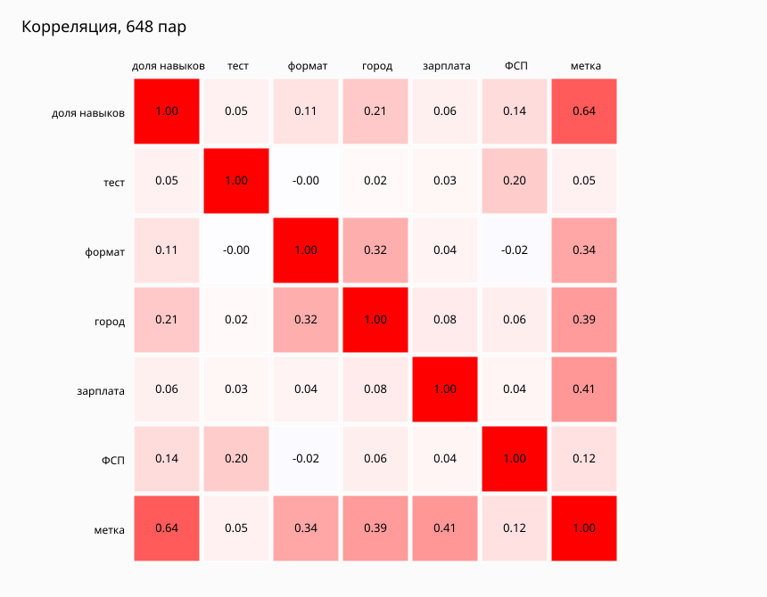
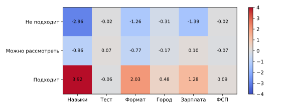
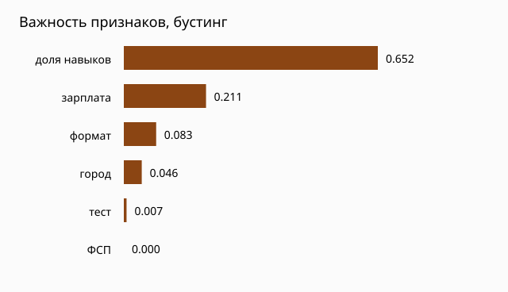

# Сравнение формулы B-14 с логистической регрессией и градиентным бустингом

Проверили, стоит ли заменять ручные веса порядка кандидатов обучаемой моделью. Сравнивали формулу B-14, логистическую регрессию и градиентный бустинг на одном учебном наборе и на одних и тех же проверочных запросах. Вывод эксперимента: в выдаче остаётся формула. Модели не улучшают порядок настолько, чтобы менять подбор.

## 1. Задача

Подбор по потребности уже отбирает людей с подтверждённым грейдом нужной специализации. Внутри этого списка порядок задаёт формула B-14: навыки, результат теста, формат, город, зарплата и достижение ФСП. Вопрос эксперимента другой: не расставит ли лёгкая модель тех же людей удачнее.

Модель не подтверждает грейд и не решает, кого пускать в список. Если бы она устойчиво выигрывала у формулы на запросах, которых не видела при обучении, её счёт можно было бы поставить на место `rank_candidates` в выдаче по потребности. Если выигрыша нет, формула остаётся рабочей сортировкой.

## 2. Данные

Отдельных оценок работодателей нет. Для разработки взят учебный набор `ml-service/data/ranking_experiment_v1`. Его создаёт `ml-service/build_ranking_experiment.py` из генератора синтетических профилей с seed `2027`.

В наборе 90 вымышленных кандидатов Backend с подтверждённым в симуляции грейдом, 48 запросов и 648 пар «запрос — кандидат». Пара — это один запрос и один человек, которого формула уже допустила бы в список. У каждой пары есть часть `train`, `validation` или `test`. Кандидаты и запросы между частями не повторяются: один человек не попадает одновременно в обучение и в проверку.

| Часть | Запросов | Кандидатов | Пар | Роль в эксперименте |
|---|---:|---:|---:|---|
| train | 30 | 54 | 540 | обучение моделей |
| validation | 9 | 18 | 54 | часть test+val; для выбора модели не использовалась |
| test | 9 | 18 | 54 | часть test+val |

Метка пары — число 0, 1 или 2. Её ставит отдельное правило скрипта, не формула B-14 и не человек. Правило смотрит, все ли обязательные навыки есть, совпал ли формат, подходит ли город и уложилась ли зарплата в потолок при одной пометке «до вычета» или «на руки». Если выполнено всё, метка 2 («подходит»). Если обязательных навыков хотя бы два и при этом подходит либо формат с городом, либо зарплата, метка 1 («можно рассмотреть»). Иначе метка 0 («не подходит»). Для удалённой работы город правило считает подходящим всегда. В этом эксперименте такую метку принимаем как временный заменитель решения работодателя.

Профили, процент теста и достижения ФСП тоже вымышлены. Достижение ФСП в наборе — отметка «хакатон, финалист» у части анкет. Она не подтверждает грейд.

## 3. Признаки

Для каждой пары посчитаны шесть чисел того же смысла, что и слагаемые формулы. Все уже лежат на отрезке от 0 до 1.

| Признак | Что означает |
|---|---|
| Доля навыков | Какая часть веса обязательных навыков запроса есть у кандидата |
| Тест | Процент синтетического теста, делённый на 100 |
| Формат | 1, если формат работы совпал, иначе 0 |
| Город | 1, если формат не удалённый и город совпал; для удалённой работы 0 |
| Зарплата | 1, если пометка зарплаты одна и ожидание не выше потолка запроса |
| ФСП | 1, если в анкете есть вымышленное достижение |

Перед логистической регрессией эти шесть чисел привели к нулевому среднему и единичному разбросу по части `train`. Иначе коэффициент процента теста и галочки ФСП нельзя было бы сравнивать. Бустинг учился на исходных числах от 0 до 1: для деревьев такое выравнивание не требуется. 

## 4. Методы

**Формула B-14.** Фиксированные веса: до 55 баллов за навыки, до 20 за тест, до 10 за формат и город, до 10 за зарплату, до 5 за ФСП. На обучающей части веса не подбирались.

**Простая сортировка.** Те же допущенные люди. Выше тот, у кого больше совпавших обязательных навыков. Вес навыка, тест, формат, город, зарплата и ФСП на место не влияют. При равенстве выше меньший идентификатор профиля. 

**Логистическая регрессия.** Мультиклассовая модель scikit-learn по меткам 0, 1 и 2. Класс «подходит» редкий, поэтому классам задан равный суммарный вес. Для порядка внутри запроса взята ожидаемая метка: `0·P(0) + 1·P(1) + 2·P(2)`.

**Градиентный бустинг.** `GradientBoostingClassifier`: `n_estimators` = 100, `max_depth` = 2, `learning_rate` = 0.1, `seed` = 2027. Для порядка использована та же ожидаемая метка. Важность признака — доля уменьшения ошибки деревьев; сумма по всем признакам составляет 1.

Модели учились только на `train`. Порядок сравнили на `test+val`: сложенные `validation` и `test`, 18 запросов и 108 пар. 

## 5. Метрики

**Место первого подходящего.** Доля запросов, в которых человек с меткой 2 стоит на первом месте. Это прямой вопрос выдачи: открывает ли список тот, кого правило назвало подходящим. На восемнадцати запросах `test+val` величина записывается как «18 из 18».

**nDCG@5.** Смотрит на пять первых мест одного запроса. Метка 2 даёт больший вклад, чем метка 1; место ближе к началу важнее места дальше. Результат делят на идеальный порядок по меткам, поэтому 1 означает полное совпадение с этим порядком. Глубина 5 взята потому, что в проверке смотрят начало списка, а не всю выдачу. 

**Precision@3.** Доля первых трёх мест с меткой 2. Метка 1 успехом не считается. Если подходящих людей мало, Precision@3 у разных хороших сортировок легко совпадает, хотя порядок внутри тройки различается. Поэтому её приводим вместе с nDCG, а не вместо неё.

## 6. Результаты

### 6.1. Связь признаков

На 648 парах признаки слабо связаны между собой. Сильнее остальных вместе ходят формат и город: корреляция 0,32. Связь с меткой заметна у доли навыков (0,64), зарплаты (0,41), города (0,39) и формата (0,34). Тест (0,05) и ФСП (0,12) с меткой почти не связаны. Это ожидаемо: правило метки собрано из навыков, формата, города и зарплаты и не использует тест и ФСП.

Рисунок 1. Корреляция Пирсона шести признаков и метки. Красное — значения растут вместе, синее — в разные стороны.

### 6.2. Порядок на test+val

На восемнадцати итоговых запросах формула, логистическая регрессия и бустинг ставят подходящего человека первым во всех восемнадцати случаях. Простая сортировка — в одиннадцати. nDCG@5 у трёх основных способов почти одинаков. Precision@3 у формулы и обеих моделей совпал.

| Сортировка | Подходящий первый | nDCG@5 | Precision@3 |
|---|---:|---:|---:|
| Формула B-14 | 18 из 18 | 0,992 | 0,370 |
| Логистическая регрессия | 18 из 18 | 0,999 | 0,370 |
| Градиентный бустинг | 18 из 18 | 1,000 | 0,370 |
| Простая сортировка | 11 из 18 | 0,917 | 0,333 |

Разница nDCG между формулой и моделями — тысячные на восемнадцати запросах. Это не основание менять выдачу. Все три способа заметно выше простой сортировки: веса и остальные признаки действительно сдвигают подходящего человека к началу списка.

Рисунок 2. Итоговое сравнение на `test+val`. Высота столбца — число запросов из восемнадцати, где человек с меткой 2 стоит первым. Подпись под названием — nDCG@5, это отдельное число, не та же дробь.

### 6.3. Коэффициенты логистической регрессии

Коэффициент относится к одному классу метки и одному признаку. Плюс увеличивает шанс этой строки, минус уменьшает.

В строке «подходит» наибольший вес у доли навыков (3,92), затем у формата (1,92) и зарплаты (1,29). Город слабее (0,39). Тест (−0,06) и ФСП (0,09) почти не влияют. Та же доля навыков сильно уменьшает шанс класса «не подходит» (−2,96). Картина совпадает с правилом меток: модель в первую очередь повторяет навыки, формат и зарплату.

Рисунок 3. Матрица коэффициентов. Строка — класс метки, столбец — признак. Красное — плюс, синее — минус.

### 6.4. Важность признаков в бустинге

Важность бустинга — другой показатель. Она показывает, какую долю уменьшения ошибки деревьев дал признак. Сумма по строкам равна 1.

| Признак | Важность |
|---|---:|
| Доля навыков | 0,652 |
| Зарплата | 0,211 |
| Формат | 0,083 |
| Город | 0,046 |
| Тест | 0,007 |
| ФСП | 0,000 |

Бустинг почти не использует тест и совсем не использует ФСП. Как и коэффициенты регрессии, это след правила меток, а не вывод о реальном найме.

Рисунок 4. Важность признаков градиентного бустинга. Длиннее столбец — большая доля уменьшения ошибки.

## 7. Вывод

Логистическая регрессия и градиентный бустинг не дают практического выигрыша относительно формулы B-14. На восемнадцати запросах `test+val` подходящий по метке кандидат и так первый у формулы и у обеих моделей: 18 из 18. nDCG различается в третьем знаке: 0,992 у формулы против 0,999 и 1,000 у моделей. Precision@3 совпадает. В выдаче по потребности остаётся формула.

