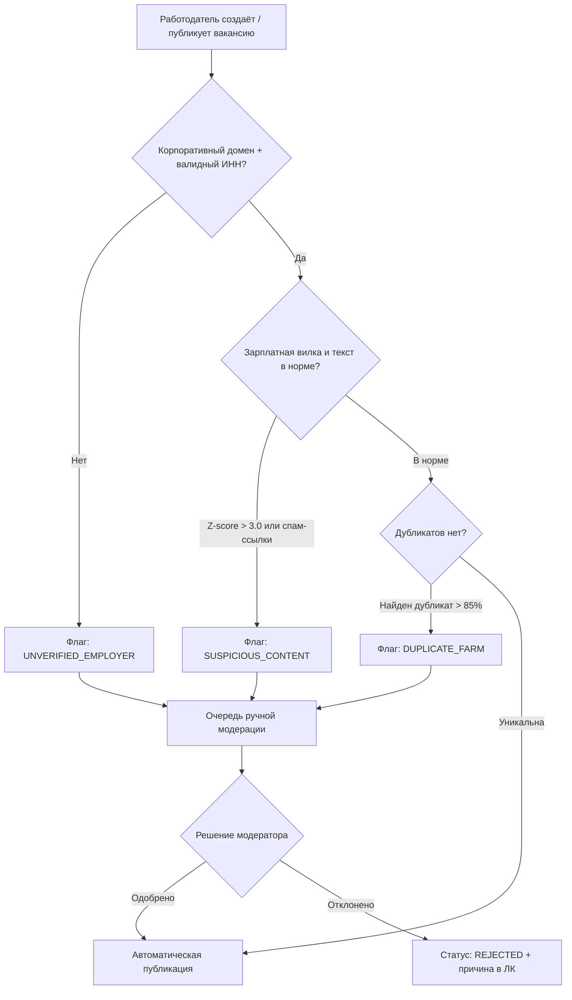
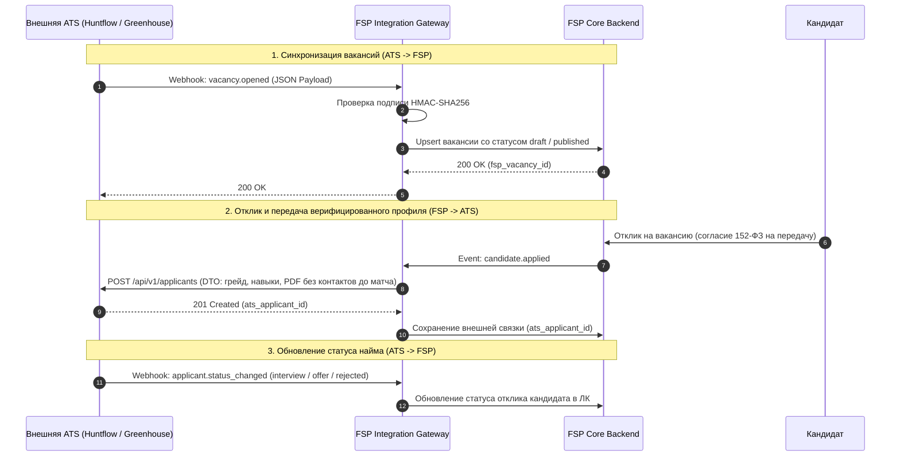

# B-37: признаки фиктивных вакансий, сценарий проверки и интеграция с ATS

Документ фиксирует правила антифрода работодателей и техническую схему интеграции платформы FSP с внешними системами управления кандидатами (Applicant Tracking Systems, ATS). Задача выполнена в рамках P2 (Султан, Алгюль); рабочая интеграция и промышленный коннектор вынесены за рамки MVP.

---

## 1. Контекст и цели антифрода

Платформа FSP связывает подтверждённый технический грейд кандидата с потребностями компаний. Появление фиктивных или недобросовестных вакансий («ghost jobs», сбор баз контактов конкурентов, фишинг, нерыночные офферы-приманки) несёт прямые риски:
1. **Нарушение 152-ФЗ и утечка данных:** недобросовестный сбор персональных данных соискателей под видом несуществующего найма.
2. **Искажение метрик подбора (B-14, B-15):** фиктивные вакансии завышают спрос и искажают взвешенные веса навыков.
3. **Репутационный ущерб:** потеря доверия со стороны сертифицированных специалистов к работодателям площадки.

---

## 2. Признаки фиктивных и подозрительных вакансий

Система классифицирует риск вакансии по трём независимым группам сигналов (юридические, содержательные и поведенческие):

### 2.1. Юридическая верификация и профиль компании (L1)
* **Отсутствие или недостоверность ИНН / ОГРН:** регистрация компании в ЕГРЮЛ менее 90 дней назад, статус ликвидации, банкротства или массового юридического адреса (> 10 организаций).
* **Некорпоративный контактный email:** использование бесплатных почтовых служб (`@gmail.com`, `@mail.ru`, `@yandex.ru`, `@bk.ru`) вместо валидированного корпоративного домена компании.
* **Несовпадение бренда:** наименование компании в профиле не соответствует данным ФНС/ЕГРЮЛ по указанному ИНН.

### 2.2. Текстовые и компенсационные аномалии вакансии (L2)
* **Экстремальные зарплатные выбросы:**
  * Завышение: Junior Backend с вилкой от 400 000 руб. (отклонение $Z > 3.0$ от рыночной медианы платформы).
  * Неправдоподобный диапазон: отношение `salary_max / salary_min > 4.0` (например, 30 000 — 350 000 руб.).
  * Нарушение типа налога: отсутствие явного указания «до вычета НДФЛ» / «на руки».
* **Текстовое дублирование (Farm Vacancies):**
  * Массовая публикация идентичного описания (Jaccard similarity $> 0.85$ по шинглам текста) под разными названиями должностей или от разных аккаунтов.
  * Полное совпадение с типовыми общедоступными шаблонами без конкретики проекта, стека и описания команды.
* **Внешний увод трафика:** наличие в тексте внешних ссылок на сомнительные телеграм-боты, платные курсы или предложения платного тестового задания.

### 2.3. Поведенческие сигналы в жизненном цикле (L3 — Ghost Jobs)
* **Мёртвая вакансия:** статус «опубликована» более 90 дней при отсутствии просмотренных откликов или отправленных приглашений со стороны работодателя.
* **Аномальный отказ:** 100% отклонений кандидатов с подтверждённым грейдом, строго соответствующим требованиям вакансии, без проведения интервью.
* **Жалобы кандидатов:** флаги в системе обратной связи («требуют предоплату», «предлагают другую работу», «не отвечают после принятия»).

---

## 3. Сценарий проверки (Антифрод-пайплайн)



1. **Предварительная валидация (Pre-commit):**
   * При создании компании обязательна верификация ИНН через DaData/ЕГРЮЛ API.
   * Email подтверждается ссылкой с одноразовым токеном на корпоративном домене.
2. **Автоматический скоринг публикации:**
   * При переходе вакансии в статус `published` рассчитывается суммарный Risk Score ($0 \dots 100$).
   * Если Risk Score $< 20$, вакансия публикуется мгновенно.
   * Если Risk Score $\ge 20$, публикация блокируется, вакансия получает статус `pending_moderation` и направляется администраторам.
3. **Мониторинг активности (TTL вакансий):**
   * Вакансия автоматически переводится в архив (`archived`) через 60 дней отсутствия действий работодателя.
   * За 7 дней до архивации высылается предупреждение о подтверждении актуальности.

---

## 4. Техническая схема интеграции с ATS

Интеграция с корпоративными ATS (Huntflow, E-Staff, Greenhouse, Lever) проектируется по гибридной модели: двусторонняя синхронизация через REST API и защищённые Webhooks.



### 4.1. Спецификация контрактов данных (DTO)

#### Входящий вебхук синхронизации вакансии (`ATSVacancySyncPayload`):
```json
{
  "ats_source": "huntflow",
  "external_id": "vac_98412",
  "company_inn": "7707083893",
  "title": "Backend Python Engineer",
  "specialization": "Backend",
  "grade": "middle",
  "salary_min": 180000,
  "salary_max": 250000,
  "salary_tax_type": "gross",
  "required_skills": ["python", "sql", "api", "docker"],
  "status": "open",
  "updated_at": "2026-10-10T12:00:00Z"
}
```

#### Экспорт кандидата в ATS с подтверждённым грейдом (`ATSCandidateExportPayload`):
```json
{
  "ats_applicant_id": null,
  "fsp_application_id": "c9a4192b-8a21-4f1e-9189-6fa244199aa0",
  "first_name": "Иван",
  "last_name": "Иванов",
  "city": "Москва",
  "verified_grade": "middle",
  "verified_specialization": "Backend",
  "verification_score_percentage": 88.5,
  "fsp_id": "FSP-77-9041",
  "fsp_verified": true,
  "skills_breakdown": {
    "backend_python": 10.0,
    "sql": 9.0,
    "api": 8.0,
    "reliability": 8.5
  },
  "additional_skills": [
    {
      "code": "git",
      "target_grade": "junior",
      "level_out_of_ten": 10.0
    }
  ],
  "standardized_pdf_url": "https://api.fsp.local/api/v1/candidates/c9a4192b/resume.pdf"
}
```

### 4.2. Безопасность и надёжность интеграции
1. **Аутентификация:**
   * Взаимодействие FSP с ATS защищено протоколом **OAuth 2.0 (mTLS / Client Credentials)**.
   * Вебхуки от ATS подписываются секретным ключом работодателя (`HMAC-SHA256`) и валидируются в заголовке `X-FSP-Signature`.
2. **Идемпотентность:**
   * Все вызовы содержат заголовок `X-Idempotency-Key: {ats_id}:{timestamp}`. Повторные пакеты дедуплицируются в Redis со скользящим окном 24 часа.
3. **Отказоустойчивость и повторы (Dead Letter Queue):**
   * При сетевых сбоях или недоступности ATS запросы ставятся в очередь Celery/Redis Streams с экспоненциальной задержкой (1 мин, 5 мин, 30 мин, 2 часа).
   * После 5 неудачных попыток запрос переносится в DLQ для ручного разбора администратором.
